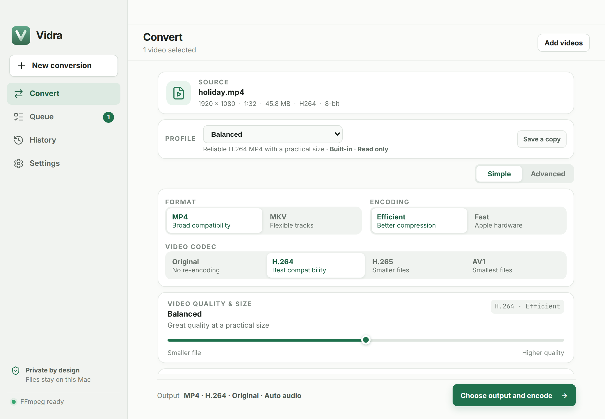
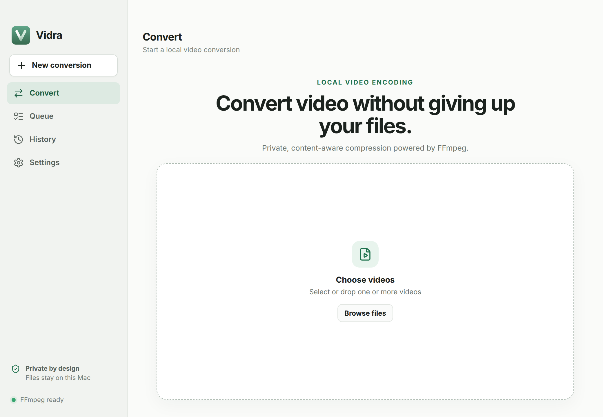
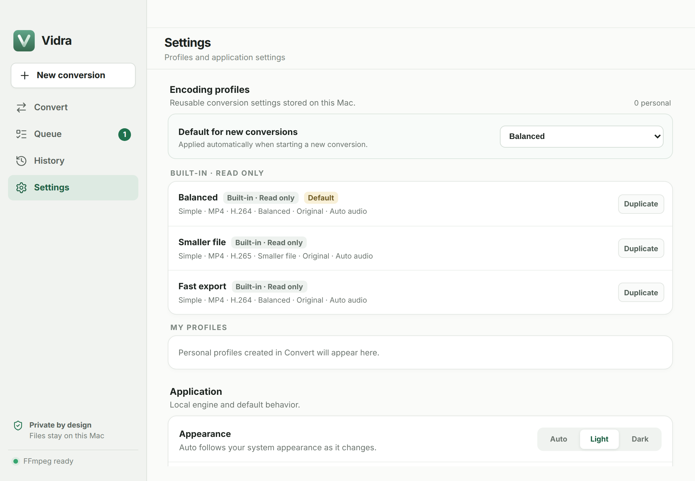

# Vidra

Vidra is an open-source desktop app that converts and encodes video on your computer. You inspect a file, choose plain-language settings, and Vidra writes a new file with the FFmpeg and FFprobe builds bundled in the app. The original file stays where it is.

**Vidra 0.1.0** is the first official release for **macOS on Apple Silicon** (macOS 12 or later). The signed and notarized installer is on the [0.1.0 release](https://github.com/mathieumaf/vidra/releases/tag/v0.1.0). There is no account. Media is not uploaded.







These screenshots are the real interface rendered in a browser with sample media data, not the packaged app.

## Privacy and safety

- Inspection and encoding run on the device. Vidra has no accounts, no telemetry, and no network conversion.
- Official builds check GitHub Releases for updates when they start. Settings can also check manually, open the source repository, or open the current release page. Those are the only network uses. An update is not installed while a job is encoding, paused, or waiting. The update channel is stored on the device. **Stable** is the default and offers official releases. **Beta** also offers newer test builds, including release candidates. Switching back to Stable leaves the installed version in place until a newer official release exists.
- Source files are never modified or deleted.
- Encoding writes a temporary file in the destination folder and moves it into place only after success. Failure, cancellation, and quitting Vidra may remove that temporary file. An existing destination file stays in place until a conversion you confirmed has succeeded, and only if that same file is still there.
- If the requested name is already taken, the finished video is saved under the next free numbered name (`holiday-2.mp4`, then `holiday-3.mp4`). A name that already ends in a number, such as `movie-2024.mp4`, keeps that number and continues with `movie-2024-2.mp4`.
- When the destination does not have enough free space for the new file, Vidra asks before continuing. A confirmed replacement keeps the existing file until success, so that file's space is not treated as free.

## Supported platforms

| Platform | Status |
| --- | --- |
| macOS, Apple Silicon | Supported. Official builds require macOS 12 or later and are signed and notarized. |
| macOS, Intel | Requires its own build and validation. Intel Macs are outside 0.1.0 and are not a prerequisite for version 1.0. |
| Windows | Planned. Later 0.x releases will add it progressively. The work is not tied to a specific version or date. Version 1.0 includes validated Windows distribution. |
| Linux | Planned, on the same terms as Windows. Linux can already compile the Rust crate and run the portable checks. That development setup is not a Linux release. |

Each public release ships the Apple Silicon FFmpeg recipe pinned for that release. A system FFmpeg install is not used. Details and the 1.0 acceptance criteria are in the [roadmap](docs/ROADMAP.md).

## Features

- Inspect a local video: container, duration, size, video and audio codecs, resolution, frame rate, bit depth, color range, color space, HDR format, subtitles, chapters, and metadata.
- Add files from the picker, by drag and drop, or with Finder Open With. Accepted extensions are MP4, MOV, MKV, WebM, AVI, M4V, MTS, and M2TS.
- Choose MP4 or MKV, and Original video (no re-encode), H.264, H.265, or AV1.
- Five quality levels: Maximum compression, Smaller file, Balanced, High quality, and Near source. Advanced mode can nudge quality slightly smaller or more detailed.
- Keep the source resolution, or limit it from 360p through 4K. Vidra does not upscale. A portrait frame uses those limits swapped, so a vertical video stays vertical. Rotation metadata is included in the size Vidra shows and limits.
- Advanced mode can also lower the frame rate to 24, 25, 30, 50, or 60 fps when that is slower than the source. It does not raise the frame rate.
- Audio can follow the source, be encoded as AAC or Opus, or be removed. Compatible tracks are copied when the container allows it. When a track must be encoded, Vidra does not raise a known source bitrate.
- Choose which audio and subtitle tracks to keep. Chapters and container metadata are kept by default and can be turned off.
- Optionally convert only part of a video. Set a start and end time, or drag the segment slider. Progress, the time remaining, and history use the real output length. Re-encoded video is cut on the selected frames. Original video is copied unchanged, so it starts on the previous saved picture and still ends at the selected time. The choice is described in [Segment trimming](docs/TRIM.md).
- Three built-in profiles — Balanced, Smaller file, and Fast export — plus personal profiles stored on the device.
- A sequential queue. One encode runs at a time. Waiting jobs can be reordered or removed, the current job can be paused, resumed, or cancelled, and more videos can be added while a job is running. Each job shows progress and an estimate of the time remaining.
- Videos that were waiting and had not started can be restored after Vidra restarts. Restoring does not start encoding by itself.
- Finished, failed, and cancelled jobs stay in a local history.
- A failed job can show a diagnostic report with source and output paths redacted. The report can be copied or saved.
- Appearance follows the system, or can be set to light or dark. Settings show the application version and the FFmpeg version bundled with that build, plus source and release links and third-party notices. Vidra 0.1.0 ships FFmpeg 8.1.2. A build from current main reports 8.1.3 when its pinned engine is ready.

Fast encoding uses Apple VideoToolbox for H.264 and H.265. Efficient encoding, and every AV1 encode, uses the bundled software encoders. AV1 input is decoded in software with dav1d.

## Formats and codecs

| Video | Efficient | Fast | MP4 | MKV |
| --- | --- | --- | --- | --- |
| Original | Stream copy | Stream copy | H.264, HEVC, AV1, and MPEG-4 sources. HEVC is tagged `hvc1` and AV1 is tagged `av01`. Other codecs switch the container to MKV. | Copies the video stream, including HDR metadata. |
| H.264 | x264, 8-bit 4:2:0 | VideoToolbox, 8-bit 4:2:0 | Yes. HDR sources are tone-mapped to SDR. | Yes. Same tone map. |
| H.265 | x265 | VideoToolbox | Yes, tagged `hvc1`. HDR and sources deeper than 8-bit stay 10-bit 4:2:0. | Yes. Same 10-bit rule. |
| AV1 | SVT-AV1 | Unavailable | Yes, tagged `av01`. Same 10-bit rule as H.265. | Yes. |

Deeper than 10-bit sources are capped at 10 bits for H.265 and AV1. Chroma is 4:2:0. MP4 output sets the fast-start flag, which places the playback information at the beginning of the file.

| Audio | MP4 | MKV |
| --- | --- | --- |
| Automatic | Copies AAC tracks. Other tracks are encoded as AAC. | Copies every audio track. |
| Original | Copies the tracks when every one is AAC. Otherwise Vidra switches the container to MKV. | Copies every audio track. |
| AAC | Copies an AAC track when its bitrate and channel layout stay as they are. Otherwise encodes AAC. | Same. |
| Opus | Switches the container to MKV. | Copies an Opus track when its bitrate and channel layout stay as they are. Otherwise encodes with libopus. |
| None | No audio. | No audio. |

When the source bitrate is known, the encoded bitrate stays at or below it.

| Subtitles, chapters, metadata | Behavior |
| --- | --- |
| MP4 subtitles | Text tracks (SubRip, ASS, SSA, MOV text, WebVTT) are converted to MOV text. ASS and SSA styling is dropped. Image-based tracks, including PGS and DVD subtitles, are left out. |
| MKV subtitles | Tracks are copied, including image-based tracks. MOV text is converted to SubRip, because Matroska cannot store MOV text. |
| Chapters and metadata | Kept for MP4 and MKV when those options are on, which is the default. |

## HDR

The conversion screen states the HDR choice before encoding. The short version:

- **Original video** copies the encoded video stream and its HDR metadata.
- **H.264** converts PQ or HLG to limited-range BT.709 SDR with a Mobius tone map, and removes mastering-display, content-light, and HDR10+ metadata from that SDR output. If the transfer characteristic cannot be established, Vidra stops and asks for Original video.
- **H.265 and AV1** keep HDR as 10-bit video and carry the source transfer, primaries, matrix, and range. When those tags are missing but can be inferred, Vidra uses BT.2020 with the detected PQ or HLG transfer. Static mastering-display and content-light metadata are passed through when the encoder supports them.
- Dynamic HDR10+ metadata is not guaranteed to survive a re-encode. Original video is the choice when that metadata has to stay intact.
- Dolby Vision can always be copied. Re-encoding is allowed only when the file has a single backward-compatible HDR base layer and no enhancement layer. That re-encode keeps the compatible HLG or HDR10 base and does not recreate Dolby Vision metadata. Profile 5, enhancement-layer, and unclassified Dolby Vision sources require Original video.

The full rules are in [docs/HDR_POLICY.md](docs/HDR_POLICY.md).

## Install

Download the Apple Silicon DMG and its SHA-256 checksum from [GitHub Releases](https://github.com/mathieumaf/vidra/releases). Verify the checksum, open the DMG, and move Vidra to the Applications folder. Use the latest official release for everyday use. Beta and release candidate builds are for testing. Distribute only signed and notarized release artifacts.

Public builds are produced by the GitHub release workflow. The process, including update channels, is described in [docs/RELEASING.md](docs/RELEASING.md).

## Build from source

Development targets macOS on Apple Silicon. Install Node.js 26, pnpm 12, Rust, and the [Tauri prerequisites](https://tauri.app/start/prerequisites/). Xcode 26 or later is needed only to regenerate the layered macOS icon. Without Xcode, icon preparation uses the checked-in fallback assets.

```sh
pnpm install
pnpm ffmpeg:prepare
pnpm tauri dev
```

`pnpm tauri dev` runs icon preparation and `pnpm ffmpeg:prepare` before the app starts. On Apple Silicon, `pnpm ffmpeg:prepare` downloads the development archive pinned in `scripts/ffmpeg/dev-archive.json`. It checks the archive SHA-256, checks that the archive contains the corresponding sources, and checks that FFmpeg and FFprobe report the version pinned on main, **8.1.3**. The published 0.1.0 app shipped 8.1.2. Prepare ad-hoc signs the tools for local use. It does not compile FFmpeg. macOS pull-request CI uses the same download.

To compile the pinned release recipe on the machine instead:

```sh
brew install autoconf automake libtool cmake meson ninja pkgconf nasm
pnpm ffmpeg:prepare -- --build
```

`VIDRA_FFMPEG_DIR` may name a directory that contains `ffmpeg` and `ffprobe` for a development or CI build, including on Apple Silicon. Release builds reject that override. A build from this tree treats the engine as ready only when both tools report 8.1.3. A different build can still satisfy the sidecar filenames, and the app explains that it is not the pinned engine.

Linux can compile the Rust crate and run the portable checks before a Linux port exists. Install the Tauri Linux dependencies and a local FFmpeg, then run:

```sh
VIDRA_FFMPEG_DIR=/usr/bin pnpm ffmpeg:prepare
```

That override is for development and CI. Do not commit generated FFmpeg binaries.

Before a pull request:

```sh
pnpm check
git diff --check
```

`pnpm check` builds the frontend, runs the tests, and runs `cargo fmt`, Clippy, and the Rust tests. The synthetic conversion corpus and the rest of the review checklist are in [CONTRIBUTING.md](CONTRIBUTING.md).

## FFmpeg and licensing

Copyright (C) 2026 Mathieu Mafille.

Vidra is licensed under [GPL-3.0-or-later](LICENSE). The application notice is in [COPYRIGHT](COPYRIGHT).

Vidra 0.1.0 ships FFmpeg and FFprobe 8.1.2. Main and upcoming builds pin 8.1.3. That newer pin is not in the 0.1.0 installer. The changelog still requires a beta or release candidate to re-validate the 8.1.3 engine before publication. The engine is built with GPL components (x264 and x265) plus SVT-AV1, dav1d, Opus, and zimg, from the checksum-pinned sources in `scripts/ffmpeg/sources.json` for that release. The corresponding sources are attached to each GitHub release. The Apple Silicon development archive on main follows the 8.1.3 recipe and is not a substitute for a published application build.

Other dependencies keep their own licenses. The notices are in [THIRD_PARTY_NOTICES.md](THIRD_PARTY_NOTICES.md) and in the app.

## Roadmap

The 0.x series continues the conversion workflow on macOS Apple Silicon. Windows, Linux, and Intel Mac builds are later work. Version 1.0 is the milestone for a dependable core workflow with validated distribution on macOS, Windows, and Linux. Milestones and acceptance criteria are in the [roadmap](docs/ROADMAP.md).

See [CONTRIBUTING.md](CONTRIBUTING.md) before opening a pull request.
