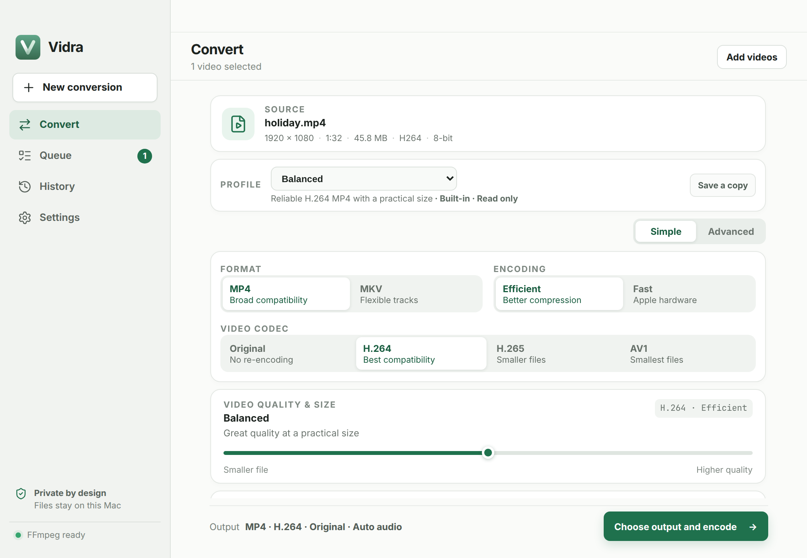
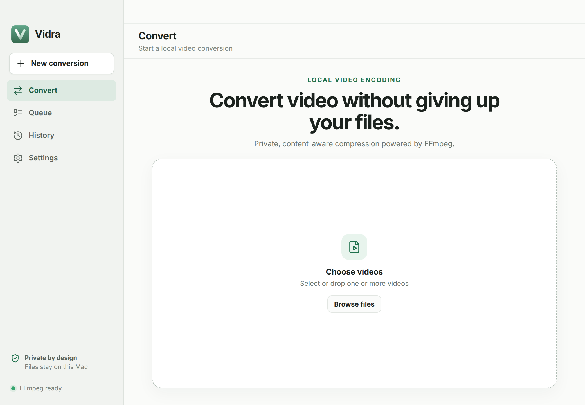
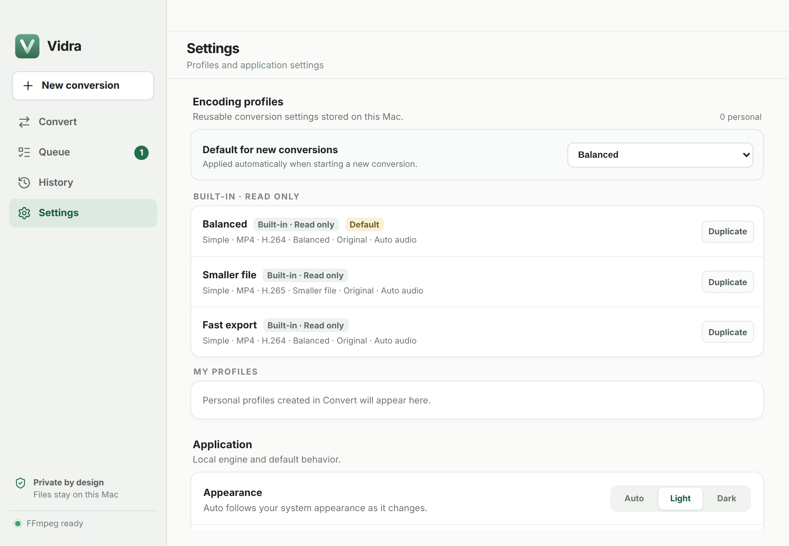

# Vidra

Vidra converts video on your Mac. You open a file, choose plain-language settings, and Vidra writes a new file with the FFmpeg build inside the app. The original stays where it is. Nothing is uploaded, and there is no account.



## Install

Vidra runs on macOS 12 or later, on Apple Silicon.

1. Download the `.dmg` from the [latest release](https://github.com/mathieumaf/vidra/releases/latest).
2. Open it and move Vidra to the Applications folder.

The build is signed and notarized. A `.sha256` file next to the DMG lets you check the download. After that, Vidra offers each new release itself: Settings has a "Check for updates" button.

## What it does

- **Inspect** a video: container, duration, size, codecs, resolution, frame rate, bit depth, HDR format, audio tracks, subtitles, chapters.
- **Convert** to MP4 or MKV with H.264, H.265, or AV1, or keep the original video stream untouched.
- **Choose quality in words:** five levels from Maximum compression to Near source, and three built-in profiles. Save your own profiles.
- **Keep what matters:** compatible audio is copied, not re-encoded. Pick the audio and subtitle tracks to keep. Chapters and metadata stay by default.
- **Handle HDR on purpose:** H.264 tone-maps to SDR, H.265 and AV1 keep HDR as 10-bit video, and the screen says which before you start.
- **Limit resolution** from 360p to 4K without ever upscaling, and optionally lower the frame rate.
- **Trim:** convert only the part between a start and an end time.
- **Queue** several videos. One encodes at a time. Pause, resume, cancel, reorder.
- **Look back:** finished, failed, and cancelled jobs stay in a local history. A failure has a report you can copy or save, with file paths removed.
- **Use the keyboard** for the whole conversion workflow. Control names and announcements for VoiceOver are described in the accessibility notes.

Files can be added from the picker, by drag and drop, or with Finder's Open With.





The screenshots show the real interface with sample media data.

## Privacy and safety

- **Nothing leaves your Mac.** No account, no telemetry, no upload. The only network use is the check for a new release on GitHub, and the links you open from Settings.
- **The source file is never modified or deleted.**
- **An existing file is replaced only when you confirmed it**, and only after the conversion succeeded. Until then it stays in place.
- **A finished video is not thrown away because its name is taken.** It is saved under the next free numbered name, such as `holiday-2.mp4`.
- **Encoding writes a temporary file** in the destination folder and moves it into place after success. Failure, cancellation, and quitting remove it.
- **Too little free space?** Vidra asks before it starts.

The exact guarantees, and their limits, are in [SECURITY.md](SECURITY.md) and the [threat model](docs/security/threat-model.md).

## Documentation

| If you want to | Read |
| --- | --- |
| Know what each format, codec, and track type becomes | [Formats and codecs](docs/FORMATS.md) |
| Understand the HDR rules | [HDR policy](docs/HDR_POLICY.md) |
| Understand trimming | [Segment trimming](docs/TRIM.md) |
| Use Vidra with the keyboard or VoiceOver | [Accessibility](docs/ACCESSIBILITY.md) |
| See what changed in a release | [Changelog](CHANGELOG.md) |
| Know where Vidra is going | [Roadmap](docs/ROADMAP.md) |
| Build Vidra or change it | [Contributing](CONTRIBUTING.md) |
| Find your way in the code | [Architecture](docs/ARCHITECTURE.md) |
| Test a change | [Testing](docs/TESTING.md) |
| Publish a release or update FFmpeg | [Releasing](docs/RELEASING.md) |
| Report a vulnerability | [Security policy](SECURITY.md) |

## Build from source

You need a Mac with Apple Silicon, Node.js 26, pnpm 12, [rustup](https://rustup.rs), and the [Tauri prerequisites](https://tauri.app/start/prerequisites/).

```sh
git clone https://github.com/mathieumaf/vidra.git
cd vidra
pnpm install
pnpm tauri dev
```

The first run downloads the pinned FFmpeg engine and checks its SHA-256. It does not compile FFmpeg, and it never uses an FFmpeg installed on your system. rustup installs the Rust version named in `rust-toolchain.toml` by itself.

Before a pull request, `pnpm check` runs the whole proof. [CONTRIBUTING.md](CONTRIBUTING.md) has the rest.

## Supported platforms

| Platform | Status |
| --- | --- |
| macOS 12 or later, Apple Silicon | Supported. Releases are signed and notarized. |
| macOS, Intel | Not built. It needs its own FFmpeg engine and validation. |
| Windows and Linux | Planned, without a date. See the [roadmap](docs/ROADMAP.md). |

## License

Copyright (C) 2026 Mathieu Mafille.

Vidra is licensed under [GPL-3.0-or-later](LICENSE). The application notice is in [COPYRIGHT](COPYRIGHT).

The bundled FFmpeg is built with GPL components (x264 and x265), plus SVT-AV1, dav1d, Opus, and zimg, from sources pinned by checksum in `scripts/ffmpeg/sources.json`. Those sources are attached to each release. The other dependencies keep their own licenses: see [THIRD_PARTY_NOTICES.md](THIRD_PARTY_NOTICES.md), which the app also shows in Settings.
